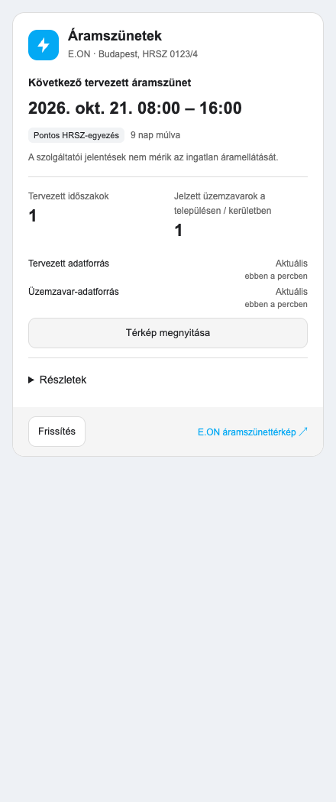
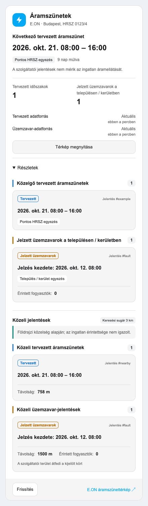

# Hungarian Power Outages Card

A Home Assistant dashboard card for [Hungarian Power Outages](https://github.com/vbalage/ha-hungarian-power-outages).
Shows the next planned outage, parcel/address matching, published faults, nearby reports and a combined map.
Includes manual refresh, feed freshness, Hungarian/English labels and a visual editor.

**Install and configure the [integration](https://github.com/vbalage/ha-hungarian-power-outages#install) first.**
The card reads its entities; it does not query E.ON independently. Requires Home Assistant **2026.9.4+**.



## Install

**HACS custom repository** (not yet in the default HACS catalog):

1. In HACS, open **⋮ → Custom repositories**.
2. Add `https://github.com/vbalage/hungarian-power-outages-card`, category **Dashboard**.
3. Download **Hungarian Power Outages Card** and reload your browser.
4. Check **Settings → Dashboards → Resources** for the JavaScript module:
   `/hacsfiles/hungarian-power-outages-card/hungarian-power-outages-card.js`.
   Add it if HACS did not register it; enable Advanced Mode in your profile if Resources is hidden.

**Manual:** download both `.js` files from [dist/](dist/) and copy them into
`/config/www/hungarian-power-outages-card/`. Register
`/local/hungarian-power-outages-card/hungarian-power-outages-card.js?v=0.1.0`
as a **JavaScript module** under dashboard Resources, then reload the browser.
Keep `leaflet.js` beside the main file; it supplies the map. On manual updates, replace both files
and change the resource's `?v=` value to avoid loading a cached version.

## Add and configure the card

Edit your dashboard → **Add card → Hungarian Power Outages**. Select the integration's device.
The editor lets you set the title and language, show/hide nearby reports or the map, and expand details by default.
Use one card per monitored device. Entities are discovered automatically, including renamed entities.

If using YAML:

```yaml
type: custom:hungarian-power-outages-card
device_id: YOUR_INTEGRATION_DEVICE_ID
language: auto
show_nearby: true
show_map: true
expanded: false
```

To change the address, HRSZ, radius or polling interval, use the **integration's** Reconfigure/Configure
screens rather than the card editor. See the [integration setup instructions](https://github.com/vbalage/ha-hungarian-power-outages#set-up-a-location).

## Use

- The overview shows the next matching interval, matching confidence, counts and last successful checks.
- **Details / Részletek** groups scheduled intervals, area faults and nearby candidates into report cards.
  Dates/counts open the corresponding Home Assistant entity details.
- **Show map / Térkép megnyitása** displays blue planned-outage and orange fault markers, grouped
  reports and your search circle. Click markers for details; filter by report type or the next 7/30 days.
- **Refresh / Frissítés** requests an update. The integration shares a 60-second cooldown across devices;
  a successful request does not always trigger another provider download. Read-only users cannot refresh.
- **Data loaded / Adatok betöltve** with a coverage note means the download succeeded but some
  provider records are incomplete. Expand the explanation for context; failed or stale feeds show warnings.

<details>
<summary>Structured details preview (demonstration data)</summary>



</details>

## Map limits and troubleshooting

The map covers your device's matches and nearby reports, **not every outage in Hungary**.
Each sensor exposes at most 25 reports. Reports without coordinates remain in the list without a marker.
Provider points and area circles are approximate; faults/nearby reports do not confirm household outages.
A zero count never means “power is OK”.

JavaScript and Leaflet are served locally. Opening the map requests OpenStreetMap tiles for the visible
area; addresses and HRSZ identifiers are not sent to the tile provider. Tiles may be unavailable while
report markers remain usable. Leaflet is bundled with its license.

If the card shows “Custom element doesn't exist”, check the module resource and reload the browser.
If no device appears, finish integration setup first. If the map fails, check that both JavaScript files
are installed together. [Report card issues here](https://github.com/vbalage/hungarian-power-outages-card/issues);
[provider/matching issues belong to the integration](https://github.com/vbalage/ha-hungarian-power-outages/issues).

## Development

Node 22+ and pnpm 11.25.0: `pnpm install --frozen-lockfile`, `pnpm check`, `pnpm format:check`,
`pnpm test`, `pnpm exec playwright install chromium`, `pnpm test:browser`, `pnpm build`.
Tests use synthetic reports and mocked map tiles. MIT licensed; Leaflet's license is in [vendor/](vendor/).

## Support

If you find this project useful, you can [buy me a coffee](https://buymeacoffee.com/balazsviszy).
Support is optional; the project remains free and open source.
